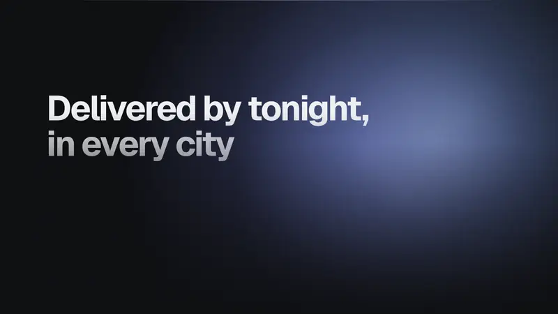
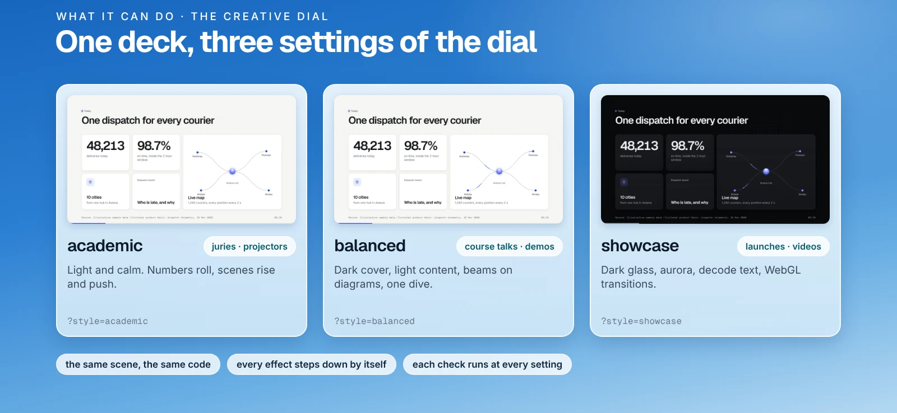
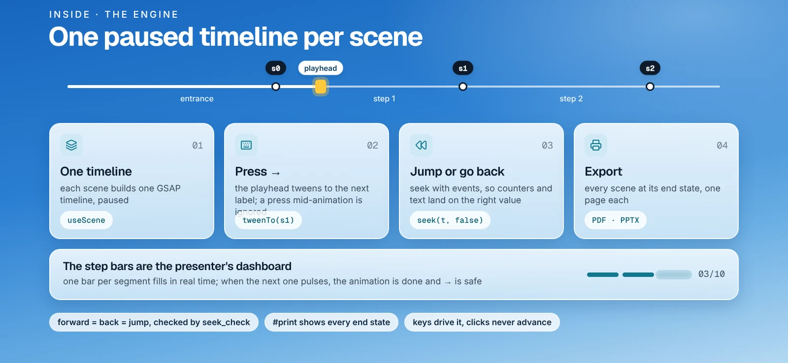
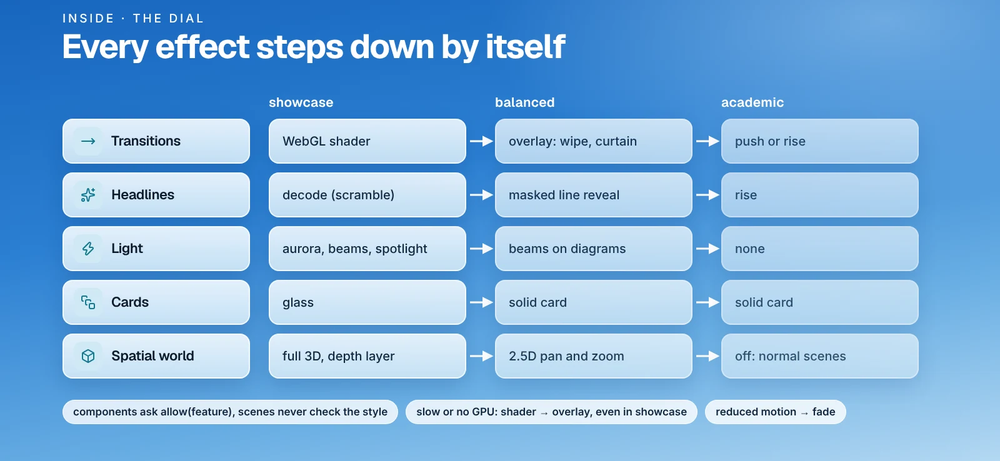
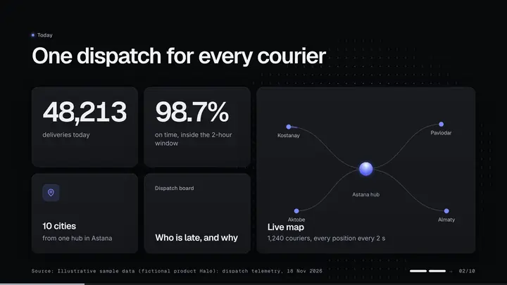
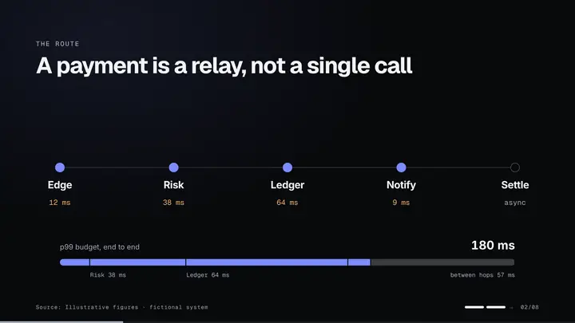
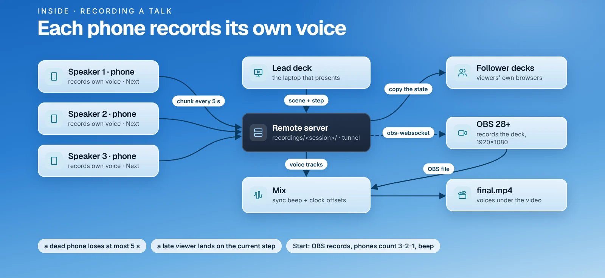
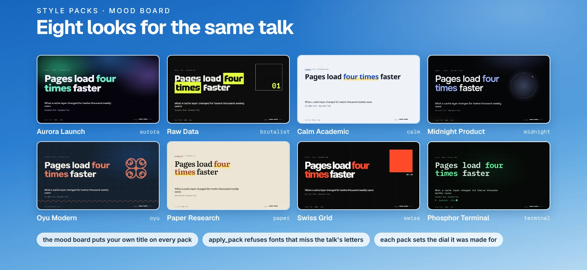

# sahna

sahna is a Claude skill and a toolkit for animated web presentations (React, Vite, TypeScript, Tailwind v4 and GSAP) that look like a product launch page instead of slides. *Sahna* means "stage" in Kazakh.

I was tired of plain PPTX decks and wanted my talks to feel like a product page. I built it for my capstone and course talks at university, and then turned it into a skill, so anyone can make such a deck with Claude. It is code-first: Claude (or you) writes the scenes as React code, and the toolkit gives the engine, the checks and the export.



## What it can do



- Set how bold the deck looks with one dial: `academic` for juries and projectors, `balanced` for most talks, `showcase` for launches and videos. `?style=` previews another setting without editing anything.
- Pick a look from eight style packs, shown on your own title in a mood board, and apply it in one command. A pack is refused if its fonts miss the letters of the talk (Kazakh included).
- Move between scenes with transitions that come out of the old scene: shared elements that fly to their new place, a dive through a dot or a screen, overlays, and WebGL shaders in showcase.
- Draw architecture diagrams as data (JSON laid out with ELK): flows light up hop by hop, a box zooms into its inside, sequence views and a few kits (tenants, failure, scale-out).
- Tell a story with data: big numbers, bars, bar races, lines with notes, waffles, funnels and a map of Kazakhstan, formatted in English, Russian or Kazakh.
- Walk through code highlighted at build time (focus, diff and run per step) and play demo videos that open from a mark in the deck.
- Fly the camera through a 3D world of scenes instead of switching slides, with an overview map on O.
- Present with a presenter window, step bars that show when an animation is done, a laser, a pen, black and white screens, and backup slides for questions that you open with `/` and leave with Esc.
- Rehearse with timing per scene and per speaker, and compare runs.
- Present from phones and record a group talk: each phone is a remote and records its own speaker, with Meet-style mic and camera buttons; the speaker's live face sits on the slide, other viewers follow the lead deck in their own browser, and OBS records the deck.
- Ship one offline HTML file, plus a PDF and a PPTX of the same scenes.
- Do all of it with one command, `sahna`: a menu for people and `--json` subcommands for Claude.

## Inside

Every scene builds one paused GSAP timeline with labels `s0`, `s1`, … and the keys only move the playhead between them. Jumps and export seek with events, so a counter shows the same number whether you pressed through, went back or jumped, and every scene has an end state for the PDF.



The dial is the only place where boldness is decided. Scenes never check the style: each component asks whether its feature is allowed and steps down by itself, so switching the dial never breaks a deck. Shaders also step down when the laptop's GPU misses the budget at load.



A transition should come out of something in the old scene. Here the dispatch card flies from the bento into the next scene and lands above its headline:



The world module keeps scenes as normal HTML panels and only moves the camera between them. At rest the active panel has no transform, so text is as sharp as in a flat deck and the export does not change.



For recorded talks, each phone records its own speaker and uploads a chunk every 5 s, so a dead phone loses at most 5 s. Followers copy the lead deck's scene and step, not its key presses, so a late viewer lands on the current step. A sync beep and the clock offsets measured during the take align the voices under the OBS video in `final.mp4`.



The eight packs on the same talk. Each one sets tokens, fonts, motion and the dial it was made for:



## Repository

- `skill/`: the skill as you install it, `SKILL.md` and `assets/`
- `skill/assets/starter/`: the engine, the dial and FX kit, transitions, presenter view, rehearsal and the checks (Python, Playwright)
- `skill/assets/modules/`: diagram, data-viz, code-scene, video-scene, remote (phones and recording) and world
- `skill/assets/packs/`, `skill/assets/tools/`: eight style packs, the mood board, `apply_pack`, `pack_lint` and a font coverage check
- `skill/assets/showreel/`: one deck that uses everything, about Halo, a fictional delivery product
- `skill/assets/cli/`: the `sahna` command (plain Node, no npm dependencies)
- `scripts/`: the Pages build, the release zip and the filming of the README animations
- `docs/`: short notes on the [engine](docs/engine.md), the [dial](docs/dial.md) and [recording](docs/recording.md)

## Requirements

Node 20.19+ or 22.12+, Python 3.10+ and Chrome. Recording also needs ffmpeg and OBS 28+, and Docker or cloudflared for the tunnel. `npx sahna doctor` checks all of it, and `npx sahna doctor --fix` installs the Python packages and Playwright's Chromium.

## Install the skill

On claude.ai: download `sahna-skill.zip` from the [latest release](https://github.com/thelol3882/sahna/releases/latest) and upload it in the Skills section of the settings. Skills need code execution to be on. The zip holds one folder, `animated-web-deck/`, with `SKILL.md` and `assets/`; `scripts/zip-skill.sh` builds the same zip from a clone.

In Claude Code, copy `skill/` into your personal skills or into a project:

```sh
git clone https://github.com/thelol3882/sahna
cp -r sahna/skill ~/.claude/skills/animated-web-deck            # for every project
cp -r sahna/skill my-project/.claude/skills/animated-web-deck   # for one project
```

Then ask Claude for a presentation. It starts with a short concept workshop: what the story is, two or three concepts, the dial and the style pack, and builds after you agree.

## Run it

Without Claude, or to work on a deck by hand:

```sh
node skill/assets/cli/bin/sahna.js new my-talk --pack midnight --style showcase
cd my-talk
npx sahna dev       # live dev server
npx sahna check     # walk, overlap, seek and wow checks, one summary table
npx sahna export    # PDF and PPTX
```

`npx sahna` alone opens a menu. Every command takes `--json`, which is what Claude uses. Inside a deck, `npx deck` still works for decks made before the rename.

The showreel and the world example run live at https://thelol3882.github.io/sahna/ (open them in Chrome, press F and →).

The scripts run locally: the checks start a headless Chromium, `npx sahna doctor --fix` runs `pip install` and `playwright install chromium`, `tools/fonts.py` asks npm for font packages, and the recording module opens a Cloudflare quick tunnel and talks to OBS over its WebSocket.

## Keys

Press `?` in any deck to see these on screen. They work the same on a Cyrillic layout, and presentation clickers send → or PageDown.

| Key | What it does |
|---|---|
| → Space PageDown | next step or scene; during an animation it finishes the animation quickly |
| Shift + → | finish the running animation now |
| ← PageUp | back |
| 1–9 Home End | jump to a scene |
| / or Ctrl/⌘ K | search the backup slides; Esc returns to the same scene and step |
| B / W | black / white screen; the same key or → brings the deck back |
| hold X | laser dot that follows the mouse |
| D | draw on the scene; Backspace undo, C clear, Esc leave |
| F | fullscreen |
| R | replay the intro |
| P | presenter window with notes, timers and the next step |
| ? | this list |

Mouse clicks on the stage never move the deck, so touching the touchpad is safe.

## Limits

- Performance was measured only in a headless browser with software rendering. Rehearse once on the laptop you present from; `__deck.gl()` shows whether shaders passed the GPU budget.
- Kazakh number and date formatting is written by hand, because Chromium ships no Kazakh locale data.
- The Kazakhstan map uses the regions before 2022 (Natural Earth): no Abai, Jetisu or Ulytau, and the slide keeps a note about it.
- The oyu pack uses a modern Kazakh ornament and should be reviewed by a Kazakh designer before a public talk.
- Recording was tested with simulated phones and a fake OBS, not with real phones and a real OBS.
- Only Chrome is tested.
- GSAP is not MIT: it comes from npm under its own license (see below).

## License

sahna's own code, docs and assets are released under the [MIT License](LICENSE).

sahna **does not include** GSAP or other npm packages: `npm install` fetches them, and each
keeps its own license. Most importantly, **GSAP is not MIT**. It is free (including SplitText,
MorphSVG and the other plugins, also for commercial use) under the
[GSAP Standard "No Charge" License](https://gsap.com/standard-license) from Webflow, and by
installing it you accept those terms. Decks you build with sahna are yours.

Fonts are installed from Fontsource under the SIL Open Font License 1.1 (one, Ubuntu Sans Mono,
under the Ubuntu Font Licence 1.0). Brand logos in diagrams come from Simple Icons and remain
trademarks of their owners, used only to name the technology. See [THIRD_PARTY.md](THIRD_PARTY.md).
